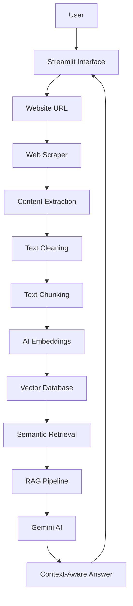

# 🌐 WebMind-AI
### 🧠 AI-Powered Website Intelligence & Knowledge Assistant

<p align="center">

**Transform Websites Into Intelligent Knowledge.**

</p>

<p align="center">

[](https://www.python.org/)
[](https://ai.google.dev/)
[](https://en.wikipedia.org/wiki/Retrieval-augmented_generation)
[](https://streamlit.io/)
[](LICENSE)

---

## ✨ Overview

**WebMind-AI** is an intelligent website analysis and knowledge discovery platform that transforms web content into meaningful insights using Artificial Intelligence and Retrieval-Augmented Generation (RAG).

Instead of manually reading lengthy webpages, users can provide a website URL, automatically extract its content, and interact with the information through natural-language questions.

WebMind-AI combines web scraping, intelligent text processing, semantic search, vector embeddings, and AI-powered reasoning into one streamlined experience.

## 🚀 Key Features

| Feature | Description |
|---|---|
| 🌐 Website Intelligence | Analyze website content through URL-based indexing |
| 🔎 Smart Web Crawling | Extract meaningful content from webpages |
| 🧹 Content Processing | Clean and preprocess extracted text |
| ✂️ Intelligent Chunking | Divide content into searchable text segments |
| 🧠 AI Embeddings | Convert content into semantic vector representations |
| 🗂️ Vector Database | Store and retrieve website knowledge efficiently |
| 💬 AI Question Answering | Ask questions directly about indexed websites |
| 🎯 Context-Aware Responses | Generate answers using retrieved website information |
| 📊 Website Analytics | Explore indexed content and knowledge statistics |
| ⚡ Semantic Search | Retrieve relevant content based on meaning |
| 💾 Website Caching | Reduce repeated processing through caching |

## 🏗️ System Architecture



## 🛠️ Technology Stack

| Category | Technology |
|---|---|
| Programming Language | Python |
| User Interface | Streamlit |
| AI Model | Google Gemini |
| AI Architecture | Retrieval-Augmented Generation |
| Web Scraping | BeautifulSoup, Requests |
| Text Processing | LangChain |
| Vector Database | ChromaDB |
| Configuration | python-dotenv |

## 📂 Project Structure

```text
WebMind-AI/
│
├── app.py
├── index_data.py
├── query_data.py
├── requirements.txt
│
├── scraper/
│   └── Website content extraction
│
├── preprocessing/
│   └── Text cleaning and chunking
│
├── embeddings/
│   └── Embedding generation
│
├── vectordb/
│   └── Vector storage and retrieval
│
├── rag/
│   └── Retrieval and answer generation
│
├── utils/
│   └── Common utilities
│
├── cache/
│   └── Website caching
│
├── .env.example
├── .gitignore
├── LICENSE
└── README.md
```

## ⚙️ Installation & Setup

### 1. Clone Repository

```bash
git clone https://github.com/Alwin0606/WebMind-AI.git
cd WebMind-AI
```

### 2. Create Virtual Environment

```bash
py -3.13 -m venv .venv
```

### 3. Activate Environment

**Windows PowerShell**

```powershell
Set-ExecutionPolicy -Scope Process -ExecutionPolicy Bypass
.\.venv\Scripts\Activate.ps1
```

### 4. Install Dependencies

```bash
python -m pip install --upgrade pip
pip install -r requirements.txt
```

### 5. Configure Environment Variables

Create a `.env` file in the project root:

```env
GOOGLE_API_KEY=your_google_gemini_api_key
```

Replace the placeholder with your API key.

### 6. Launch Application

```bash
streamlit run app.py
```

The application will open in your browser:

```text
http://localhost:8501
```

## 🔍 How WebMind-AI Works

1. **Submit Website:** Enter a public website URL.
2. **Extract Content:** The crawler retrieves relevant webpage information.
3. **Process Content:** HTML is cleaned and converted into readable text.
4. **Generate Embeddings:** Text chunks are transformed into vector embeddings.
5. **Index Knowledge:** Embeddings are stored in ChromaDB.
6. **Ask Questions:** Users submit questions in natural language.
7. **Retrieve Context:** Semantic search finds relevant website content.
8. **Generate Answers:** Gemini produces context-aware responses based on retrieved information.

## 💡 Use Cases

- 📚 Research and knowledge discovery
- 📖 Website documentation analysis
- 🎓 Educational content exploration
- 🏢 Business website intelligence
- 📰 Article summarization and analysis
- 💻 Technical documentation assistance
- 🔎 Information extraction from public websites

## 🔐 Security & Responsible Usage

- Protect API keys using environment variables.
- Never commit `.env` files or credentials.
- Respect website terms of service and crawling restrictions.
- Follow robots.txt policies where applicable.
- Apply reasonable request limits and timeouts.
- Avoid crawling private, restricted, or unauthorized content.

## 🔮 Future Roadmap

- [ ] Multi-website knowledge indexing
- [ ] Advanced conversational memory
- [ ] Source citations for AI responses
- [ ] PDF and document intelligence
- [ ] Hybrid search using keyword and vector retrieval
- [ ] Advanced website analytics
- [ ] User authentication and workspace management
- [ ] Improved crawling and content extraction
- [ ] Docker-based deployment
- [ ] Enterprise knowledge management integration

## 👨‍💻 Developer

**Alwin0606**

GitHub: [@Alwin0606](https://github.com/Alwin0606)

Project Repository: [WebMind-AI](https://github.com/Alwin0606/WebMind-AI)

---

## 📄 License

This project is licensed under the **MIT License**. See the [LICENSE](LICENSE) file for details.

---

<p align="center">

### 🌐 WebMind-AI

**Understand the Web. Discover Knowledge. Think Smarter.**

⭐ If you find this project useful, consider giving it a star!

</p>
